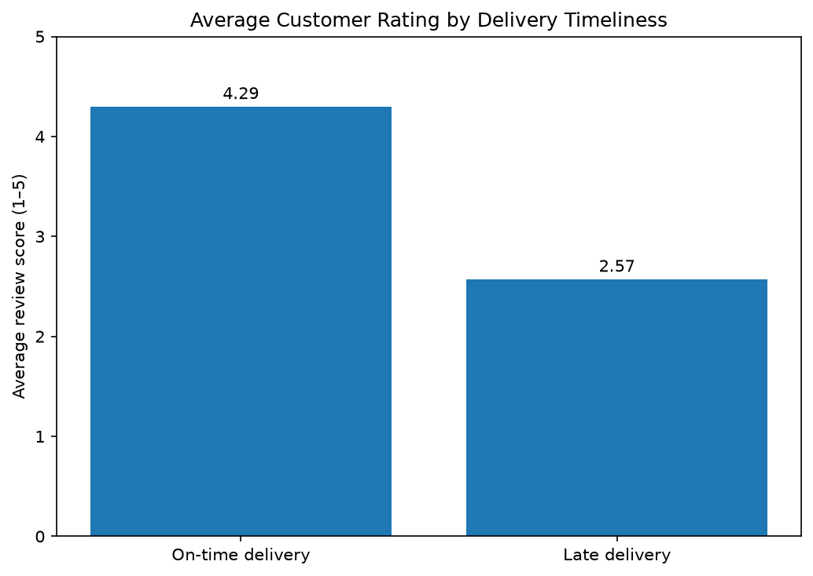
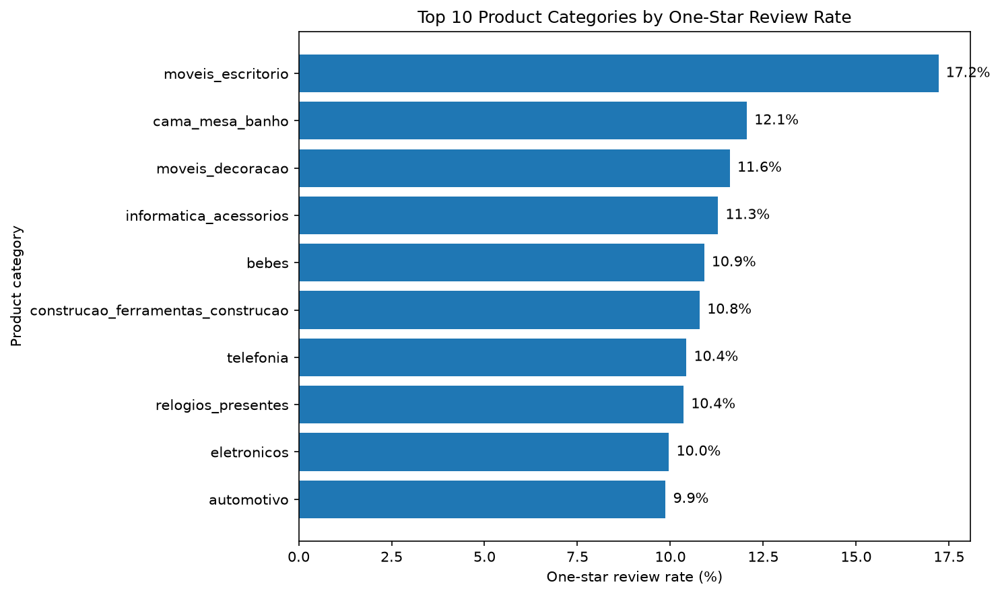

# Brazilian E-Commerce Data Analysis

## Project Overview
This project analyzes the Brazilian E-Commerce Public Dataset by Olist to explore sales performance, customer purchasing behaviour, product categories, delivery performance, and customer reviews.

The goal is to turn raw e-commerce data into useful business insights that can support better operational and customer-experience decisions.

## Business Questions
- How does delivered sales value change over time?
- Which product categories contribute the most to delivered sales value?
- How do one-time and repeat customers compare in purchasing behaviour?
- How frequently are orders delivered later than estimated?
- Is delivery timeliness associated with customer review scores?
- Which product categories have higher one-star review rates?

## Tools and Technologies
- Python
- Pandas and NumPy
- Matplotlib and Seaborn
- Jupyter Notebook

## Analysis Performed
- Data loading, cleaning, and datetime conversion
- Order and payment aggregation
- Monthly delivered item-value analysis
- Customer purchasing and repeat-customer analysis
- Product and category performance analysis
- Delivery-time and late-delivery analysis
- Customer review-score analysis

## Key Findings

- **Delivery performance:** An estimated 91.89% of delivered orders with available delivery dates arrived on or before the estimated date.
- **Customer retention:** Repeat customers represented approximately 3.00% of delivered customers but accounted for around 5.60% of delivered-order payment value.
- **Customer spending:** Repeat customers had an average delivered-order payment value of approximately ₹308.59 per customer, compared with ₹160.76 for one-time customers.
- **Customer experience:** Orders delivered late had a lower average review score (2.57/5) than orders delivered on time (4.29/5), indicating a strong association between delivery timeliness and customer satisfaction.
- **Product category performance:** Health and beauty, watches and gifts, and bed, bath and table were among the leading categories by delivered item value.
- **Operational opportunity:** The analysis highlights delivery timeliness and customer retention as areas worth investigating to improve the customer experience and encourage repeat purchasing.
  
  ## Visual Insights

### Customer Reviews and Delivery Timeliness

### Product Category Performance

## Project Files
- `notebooks/ecommerce_analysis.ipynb` — notebook containing the analysis.
- `data/` — local dataset files used by the notebook; raw data is not included in the public repository.

## Dataset
Brazilian E-Commerce Public Dataset by Olist, available through [Kaggle](https://www.kaggle.com/datasets/olistbr/brazilian-ecommerce).

## How to Run
1. Clone or download this repository.
2. Install the required Python packages.
3. Download the dataset and place the required CSV files in the `data/` folder.
4. Open `notebooks/ecommerce_analysis.ipynb` in Jupyter Notebook.
5. Run the notebook cells from top to bottom.

## Notes
This is an exploratory data analysis project. The findings describe patterns and associations in the dataset and should not be interpreted as proof of causation.
